# The workshop tools with an OpenRouter key

## Youth AI Lab - Erasmus+ project

- **Partners:** L.A.B. (Aix-en-Provence), UAB (Barcelona), Perlatecnica (Naples), Digitale Wolven
  (Antwerp), CSC Vent des Îles (La Rochelle)
- **Need help?**
  - Read [Part 7 - When a request fails](#part-7---when-a-request-fails).
  - Look at, or open, an [issue](https://github.com/Youth-AI-Lab/yal-openrouter-guide/issues).
- **Working with young people?** Read
  [Part 8 - Data and young people](#part-8---data-and-young-people) first.

> **A recipe for the facilitator. Time: TO BE COMPLETED (no person has followed it yet).** You open
> an OpenRouter account, buy credits, make one key per pair with a spending limit, and paste each key
> in `workshop-login`. Every tool of the workshops then runs without Claude.

This guide is for youth workers, facilitators and educators who run the
[workshops of the Youth AI Lab project](https://github.com/Youth-AI-Lab/yal-workshop-kit#the-series)
or use the [Open WebUI guide](https://github.com/Youth-AI-Lab/yal-openwebui-guide). It has no
Codespace of its own: you use it in the Codespace of a workshop, of the kit or of the Open WebUI
guide.

**With an Anthropic key**, you do not need this guide: follow
[SETUP.md](https://github.com/Youth-AI-Lab/yal-workshop-kit/blob/main/SETUP.md) of the kit, or
[Your Anthropic API key](https://github.com/Youth-AI-Lab/yal-openwebui-guide#your-anthropic-api-key)
in the Open WebUI guide. The two kinds of key use the same commands.

> [!NOTE]
> OpenRouter changes its pages, prices and quotas. Unless a line gives another date, what this guide
> says about OpenRouter was read on 2026-11-01. The pictures of the account pages date from 2026-11-02.

---

## Goals

| Part | You will be able to... |
|---|---|
| **1. Choose** | Say what OpenRouter is, when to choose it, and what stays Anthropic only. |
| **2. The account** | Open an account in the right name, buy credits, and set the alerts. |
| **3. One key per pair** | Make keys with a credit limit, and know what happens at the limit. |
| **4. One command** | Save a key with `workshop-login`, read each message, and choose a model. |
| **Before and during a session** | Prepare the week before and the day before, follow the spending, and react to a key that leaks. |
| **5. The tools** | Say which model each tool uses, and what differs from an Anthropic key. |
| **6. The models** | Read the table of 2026-11-01, read a model page, and say why a group cannot rely on free models. |
| **7. When a request fails** | Recognise a 429, a 402, a 403 and a 503, and know what to do during a session. |
| **8. Data and young people** | Turn on what the warning asks, and say what no setting removes. |
| **9. Sources and status** | Check the sources and the notes on the measures. |

### Prerequisites

You need an adult who holds the OpenRouter account and has a way to pay
([Part 2](#part-2---the-account)), and a Codespace of a workshop, of the kit or of the Open WebUI
guide, already open. [SETUP.md](https://github.com/Youth-AI-Lab/yal-workshop-kit/blob/main/SETUP.md)
of the kit says how to open one. If you cannot use a Codespace, see the
[dev containers guide](https://github.com/Youth-AI-Lab/yal-devcontainer-guide). Before any session
with young people, you also need your organisation's data protection contact
([Part 8](#part-8---data-and-young-people)). This is the person who answers for personal data in
your organisation. If you have none, ask whoever signs for your organisation.

### Words in this guide

- **Codespace:** a ready computer in your web browser, from GitHub.
- **Pair:** two participants who share one Codespace and one key.
- **Kit:** the files and commands of the workshops.
- **Model:** the program that writes the answers.
- **Company:** a firm that runs a model. OpenRouter calls it a provider.
- **Endpoint:** one company running one model in one place.
- **Token:** a piece of a word. Models are priced per million tokens.
- **Prompt:** a text sent to a model.
- **Window:** how much a model can read at once.
- **Mode:** one stage of the chatbot in the workshops ([Part 6](#part-6---the-models-on-2026-11-01)).
- **`replay`:** asks the chatbot all the test questions, each in a new session, and writes the
  answers to a file.
- **`score`:** asks a model, the judge, to mark those answers.
- **`./sorter`:** the small message sorter of workshop 6.
- **Open WebUI:** a chat website that runs in your Codespace.
- **`replay RAG`:** the same questions, put to the Open WebUI chatbot that finds the pieces of the
  documents closest to each question (RAG) and gives them to the model.
- **Can use tools:** can search files or call an outside service.
- **UTC:** the world reference time. Midnight UTC is 1:00 in Naples in winter, 2:00 in summer.

---

## Part 1 - Choose your key

OpenRouter is a company that gives you one key for the models of many companies. You buy credits
from OpenRouter. It sends each question to a company that runs the model you chose.

| | Anthropic key | OpenRouter key |
|---|---|---|
| The key starts with | `sk-ant-` | `sk-or-` |
| Models | Claude | many companies; no Claude model by default |
| Engine of the chatbot | Claude Code, or OpenCode if you choose it | OpenCode, always |

Choose an **OpenRouter key** if you want the workshops without Claude, or want to try other models.
Choose an **Anthropic key** to follow the workshop pages as they are.

**What stays Anthropic only: Claude Code.** In the workshops it accepts Anthropic keys only. An
OpenRouter key always runs in OpenCode, a free and open-source program that runs the same chatbot
with the same commands.

`openwebui` has two modes in these pages. **Kit mode** is the one of the workshops: each pair has its
own Open WebUI, with no accounts. **Class mode** is the one of the
[Open WebUI guide](https://github.com/Youth-AI-Lab/yal-openwebui-guide): one facilitator opens one
Open WebUI to a group, with accounts.

> [!NOTE]
> The costs, the context gauge and the scores printed in the workshop pages were measured with
> Claude. They do not hold with an OpenRouter key. What was measured with OpenRouter is in
> [Part 6](#part-6---the-models-on-2026-11-01).

---

## Part 2 - The account

An OpenRouter account holds money, and its holder answers for every request made with its keys. So
this part takes more care than a usual sign-up. At the end you have an account in the right name,
credits that cover your pairs, and an e-mail alert before the money runs out.

Do this part on your own, never with your screen projected. Start at least one working day before
the session: the [checklist](#before-the-session-prepare-the-account) says why.

### Decide who holds the account

The holder is an adult. OpenRouter's [terms](https://openrouter.ai/terms) say: "You must be at least
18 years of age to use the Service." If you act for an organisation, you must have the authority to
bind it. Its [data processing agreement](https://openrouter.ai/data-processing-agreement) then
applies: through the terms on the Free and Standard plans, and as a signed copy on request from the
Business plan.

The holder also pays for what goes wrong. The terms say: "You are responsible for all activity and
charges under its account or API Credentials, whether or not authorized by you", unless OpenRouter
itself broke its terms. So name one person who owns the account. We also advise an e-mail address
that the organisation keeps, so that the account does not leave with someone.

A personal account is enough for a session. An **organization** is a separate account with a shared
pool of credits, useful only if several adults share the billing. Decide this before your first
purchase: OpenRouter does not convert a personal account.

<details>
<summary>If you choose an organization</summary>

Credits may not move later, because OpenRouter's pages do not agree. The
[organization page](https://openrouter.ai/docs/cookbook/administration/organization-management)
allows a transfer with two-factor authentication. Your membership must be old enough, and an
organization that just received a transfer must wait before the next one. Neither delay is given.
The terms say that credits are non-transferable. So do not rely on a transfer.

An organization has at most 10 members unless support agrees. Only its admins buy credits and see
billing, and members see each other's usage (model, cost, timing). One treasurer as admin is enough:
the pairs never need a member account, they only get a key.

</details>

### Open the account

1. Go to <https://openrouter.ai/sign-up>. On 2026-11-01 it offers **Continue with GitHub**,
   **Continue with Google**, **Continue with MetaMask** (a crypto wallet), or an e-mail address and a
   password. The form asks you to agree to the Terms of Service, the Privacy Policy and the Model
   Terms. We advise the e-mail address and a password (our advice): the address stays with the
   organisation, and whether two-factor authentication applies to a Google or GitHub sign-in is not
   confirmed.
2. Turn on two-factor authentication, which asks for a second proof at sign-in. OpenRouter requires
   it only to move credits to an organization, but this account holds your money. The documentation
   gives the path **Settings > Preferences**, **Manage**, then the **Security** tab. Another page
   calls the button **Manage Account**. On 2026-11-02 the Credits page also has a link, **Enable
   two-step verification on your account to transfer credits** (not tested).
3. Only for an organization: in **Settings > Preferences**, section Organization, click **Create
   Organization**. You need a verified e-mail address.

### Buy credits

Buy credits before you make keys. OpenRouter sells four plans: Free, Standard, Business and
Enterprise. Standard is pay-as-you-go: you pay for what you use, and there is no subscription.

Every request of the kit carries a rule on data ([Part 5](#part-5---the-tools)), and the
[pricing table](https://openrouter.ai/pricing) gives that kind of routing, **Data Policy-Based
Routing**, to the Standard plan and above, not to the Free plan. An account that had bought nothing
did answer with this rule on 2026-11-01, on paid models, but it stopped with a 402 after $0.17 of
overdraft ([402](#402-no-credits-or-a-limit)). So do not plan on it.

After our first purchase, OpenRouter stopped marking the account as a free one. Whether a first
purchase moves you to Standard by itself: TO BE COMPLETED.


Frame 4 is the rule of the kit. Frame 5 comes back in [Part 8](#required-hosted-in-europe).

One purchase goes from $5 to $25,000, with no volume discount. You pay a fee when you buy credits,
and each request then costs the company's list price. OpenRouter's pages do not give the same fee:
the pricing page says 5.5 % on the Standard plan, and the [FAQ](https://openrouter.ai/docs/faq) says
5.5 % with a $0.80 minimum (read on 2026-11-02). The purchase window asked for more, so read that
window before you pay. This is what it showed on 2026-11-02, with our billing address and nothing
paid:

| Credits | **Service fees** | **Sales Tax / VAT** | **Total due** |
|---|---|---|---|
| $10 | $0.85 | $2.17 | $13.02 |
| $100 | $5.93 | $21.19 | $127.12 |

With this address, plan about 30 % on top of the credits. Prices do not include taxes: Stripe, the
payment company, adds VAT or GST at purchase where your country requires it. Here it was 20 % of the
credits plus the fee. The rate for an association is not confirmed. All payments
through Stripe are in US dollars, so write your budget in dollars. Your bank may add a conversion
cost (our inference, amount unknown).

The Standard plan accepts credit and debit cards, AliPay and USDC (a crypto currency). Paying against an
invoice, and purchase orders, are for Enterprise only. No bank transfer or SEPA is listed, and PayPal is only
announced. An association without a card must solve this first. We advise against crypto: it is never
refunded.

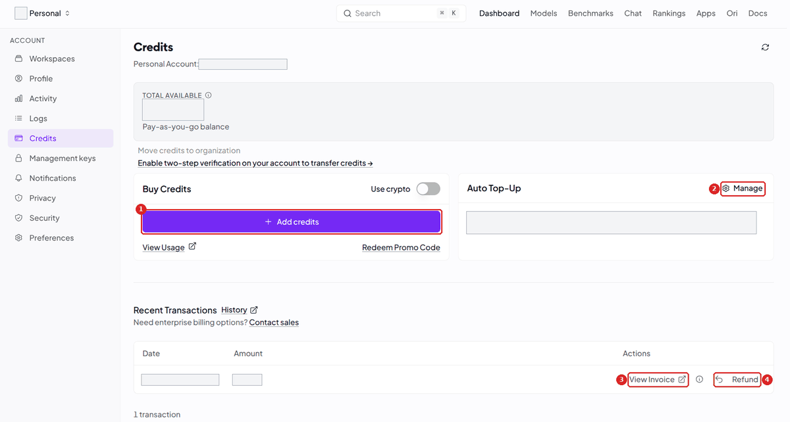

1. Open the [Credits page](https://openrouter.ai/settings/credits) and click **Add credits**
   (frame 1). A window **Purchase Credits** opens.
2. Leave **Send me invoices** on. The first time, the documentation says that this window asks for a
   billing address, then a payment method. Our picture comes from an account that had already paid.
3. If your organisation has a VAT number, expand **Edit Tax ID** before you pay, choose the country,
   enter the number and click **Save**. It only goes on future invoices. A correction goes through
   the [Support](https://openrouter.ai/support) page.
4. Under **Amount**, enter the amount in dollars ([how much](#what-a-session-costs)). Read **Service
   fees**, **Sales Tax / VAT** and **Total due**, then click **Purchase**.
5. Wait for the credits. They can take up to one hour to appear. If you have no receipt e-mail, your
   card may have been declined: try another card or payment method.

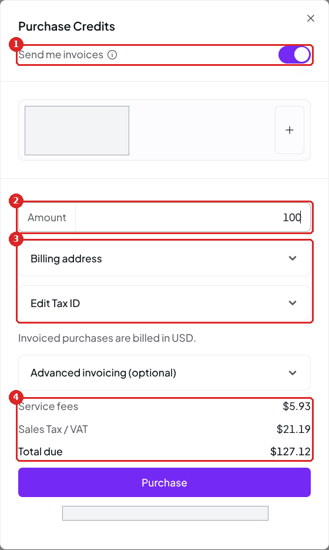

Frame 4 is the line for your budget. For your project accounts, each purchase has a **View Invoice**
link under **Recent Transactions** on the Credits page (frame 3 of the first picture).

Within 24 hours, the **Refund** button on the Credits page (frame 4 of the first picture) returns
unused credits to your payment method, without the fees. After 24 hours, unused credits are
non-refundable, except at termination or where the law requires it. Fees are never refunded. OpenRouter also reserves the right to expire unused
credits 365 days after purchase, and deleting the account loses them. So a project over two years
buys small amounts, not a stock (our advice).

### Leave auto top-up off

Auto top-up buys credits without you, when the balance falls under an amount you set. Leave it off.
OpenRouter warns about it in its
[documentation](https://openrouter.ai/docs/api_reference/authentication): "A key with no limit lets
a leaked key or a runaway agent spend your entire balance, including any auto top-ups." Keep a credit
limit on every key ([Part 3](#part-3---one-key-per-pair)).

To check it, click **Manage** in the box **Auto Top-Up** of the Credits page (frame 2 of the first
picture). The window has one switch, and it was off on our account on 2026-11-02.

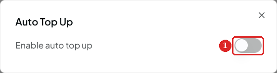

### Set the alerts

The Standard plan warns you by e-mail about the whole balance. An alert for each key exists on the
Business and Enterprise plans only, so this alert is the one you get.

1. Open [Settings → Notifications](https://openrouter.ai/settings/notifications).
2. Turn on **Low balance alert** and set its amount. The default on 2026-11-01 is $100, too high for a workshop
   account. We suggest the sum of the limits of one session: with 6 pairs at $1, set $6. The e-mail
   then comes when the balance no longer covers a full session.
3. Turn on **Model deprecation alert**. It writes when a model in recent use is going to be retired.

Nobody has checked whether these alerts start on or off (not tested).

### What a session costs

This is an estimate: no full session was measured. In our runs, a `replay` of 11 questions showed
$0.01 to $0.02. We assume a pair asks about as much as four replays in one session, 44 questions:
about $0.08. The worst case is all 44 in mode B at list price, about $0.51 (70,000 tokens at $0.165
per million, with `mistral-small-2603`). So we suggest a limit of **$1 per key for one session**, and
**$3 for a key that follows the six workshops**. Workshop 2 is the one that uses mode B, which sends
all the documents with each question, so we do not multiply $1 by six.
[Part 6](#part-6---the-models-on-2026-11-01) gives the costs that were measured.

Buy credits for the number of pairs, plus the fee and the taxes. For 6 pairs at $1, you need $6 of
credits. In [the table above](#buy-credits), $10 of credits cost $13.02 in all. Keep a margin above
the $6, because OpenRouter can refuse requests on a small balance or a new account while
money is left ([402](#402-no-credits-or-a-limit)). OpenRouter gives no figure. Our suggested margin:
TO BE COMPLETED (not tested). A request that fails takes no money: OpenRouter writes that "An attempt that errors is not
charged for its model tokens".

---

## Part 3 - One key per pair

A key is a password that spends money, so each pair gets its own. A key that leaks then spends one
limit instead of your whole balance, you can read each pair's spending apart, and you can stop one
pair without stopping the others.

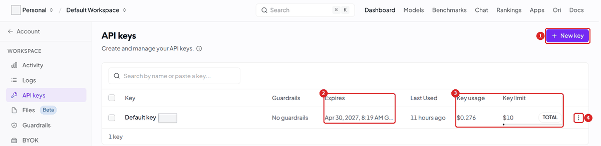

1. On the page [**API keys**](https://openrouter.ai/keys), click **New key** (frame 1 above). The
   documentation calls this button **Create API Key**.
2. In the window, fill in **Name** (frame 1 below). Name the key after the pair, the place and the
   date, for instance `pair-3-aix-2026-11`. The names stay visible in the pages that follow the
   spending, so never use a young person's name.
3. Choose **Expiration** (frame 2). This field is required. Take a value that ends shortly after your
   last session, and read the date under the field. OpenRouter writes: "You can't change the
   expiration of an existing key." The list of values other than `7 days`: TO BE COMPLETED.
4. Under **Key limit**, set **Credit limit** (frame 3): choose **Custom amount** and type the amount in
   dollars. We suggest $1 for one session, $3 for the six workshops
   ([our estimate](#what-a-session-costs)). OpenRouter recommends a limit on every key. You may also
   leave it without a limit: do not.
5. Leave **Reset limit every...** on **N/A** (frame 4). The limit then caps the whole use of the key,
   as the sentence under the amount says.
6. Click **Create** (frame 5). Copy the key. It starts with `sk-or-`. Put it at once in a private
   note: OpenRouter says that a management key is shown only once, and an ordinary key probably is
   too (not tested).
7. Do it again for the next pair.
8. Give each pair its key in private, in a direct message or on paper. Never show a key on the
   projected screen.


On the **API keys** page, each line then shows the expiry date (frame 2 of the first picture) and
what the key has spent against its limit (frame 3).

OpenRouter may make a first key for you when you sign up. Its documentation gives this key a limit
of $100 and an expiry after 180 days, and the `Default key` in our picture shows $10, so read your
own line. Lower that limit before a pair uses it, or make your own keys.

### At the limit

OpenRouter writes: "Once a key has used its credit limit, requests with it are rejected until you
raise the limit on the key's page, or, for a daily, weekly, or monthly limit, until the limit
resets." With **N/A**, nothing resets. On the key's own page, a daily limit resets at midnight UTC, a
weekly one on Monday, a monthly one on the 1st.

After `replay`, `score` or `./sorter`, you see one of the messages of
[Part 7](#402-no-credits-or-a-limit). OpenRouter's page cites this case under both 402 and
[403](#403-a-limit-or-a-rule-of-yours), so you may see either. Nobody has reached a real key limit
yet (not tested).

To raise a limit, open the key from the **API keys** page, change **Credit limit** (frame 4) and
confirm with the check mark. The expiry date cannot change (frame 3). The buttons of frame 2 show the
**Activity** and the **Logs** of this key alone.

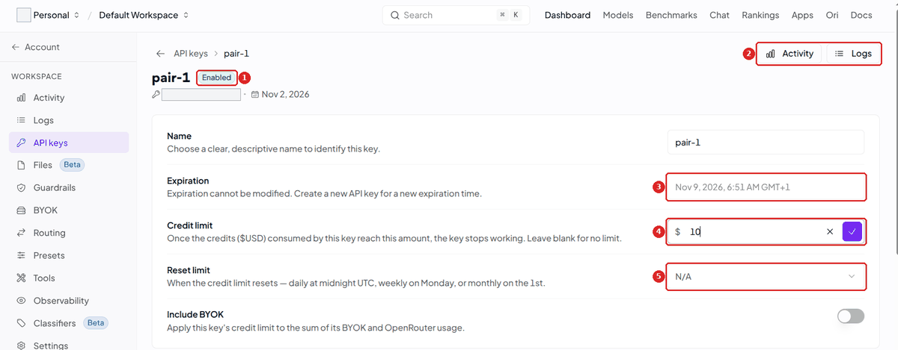

The kit keeps answers short enough that a small limit does not stop a short question.

### Optional: one ceiling for the whole group

You do not need this: the limit of each key already caps each pair. A workspace budget adds one total
for the group, so that an accident stops at a number you chose. A **workspace** is a group of keys
with its own settings. Your account already has a **Default workspace**. The Standard plan allows 5,
so one per partner or per group is possible, and credits stay shared across them. If you create
one, make its keys inside it.

1. Open the **Settings** page of the workspace. For the Default workspace:
   <https://openrouter.ai/workspaces/default/settings>.
2. Scroll to **Budgets** and click **Add budget**.
3. Choose **lifetime**, which never resets, and enter the number of pairs times the limit of a key.
4. Click **Save**.

Requests already running finish, so the spending can pass the budget slightly. After that, every
key of the workspace stops, and the tools print the lines of [Part 7](#403-a-limit-or-a-rule-of-yours).
Nobody has set a real budget yet (not tested).

---

## Part 4 - One command: `workshop-login`

This command is the only link between your key and the tools. It saves the key, checks it, and
chooses the model.

Each pair does this once, in its own Codespace, with the key you gave it. Do it once yourself first
with one key, to know what they will see. In the terminal:

```bash
workshop-login
```

Paste the key of the pair, then press Enter. You see one `*` per character. The first time, the
browser may ask for permission to paste: accept, then paste only once. The command tests the key,
then sends one very short request to the model. You must see:

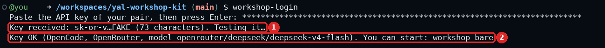

Frame 2 is the line that counts. This is a test picture, made with a fake key and no real account.

In the Open WebUI guide (class mode), you see a warning first:

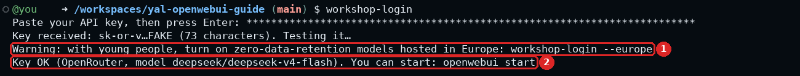

That warning is explained in [Part 8](#part-8---data-and-young-people).

### What each message means

Find what the command printed in the first column. Start from the end: a last line such as
`Nothing saved.` can follow the line that matters. Lines with `HTTP 429` or `HTTP 503` lead to
[Part 7](#part-7---when-a-request-fails).

| You see | It means | You do |
|---|---|---|
| `Nothing was pasted. Copy the key again, then type workshop-login and paste it once.` | The command received nothing. | Copy the key again, and do what the line says. |
| `The key seems to have been pasted twice. Type workshop-login again and paste it only once.` | Two keys arrived as one. | Do what the line says. |
| `This does not look like a key (it should start with sk-ant-, or sk-or- for OpenRouter with OpenCode). Nothing saved.` | The text pasted is not a key. In the Open WebUI guide, the line ends with `for OpenRouter). Nothing saved.` | Copy the key again from your private note. |
| `OpenRouter could not be reached (network?). Your earlier key is kept. Type workshop-login again.` | No answer came from OpenRouter. | Check the network, and look at OpenRouter's [status page](https://status.openrouter.ai/). |
| `--europe needs an OpenRouter key (sk-or-…). This is an Anthropic key. Nothing saved.` | You typed `--europe` and pasted an Anthropic key. | Paste the OpenRouter key. |
| `Key saved, but this OpenRouter account has no credits left. Add credits, or choose a free model: workshop-login --models free` | The account is empty, or this key is at its limit. | Add credits, or raise the limit. |
| `Key saved, but this key has reached its spending limit. Tell the facilitator.` | The key is at its credit limit, or its workspace at its budget. A guardrail can also print this line. | Read [403](#403-a-limit-or-a-rule-of-yours). |
| `Key saved, but no company can serve the model <name> under the workshop's data rule. Choose another model: workshop-login --models openrouter` | Your rules leave no company for this model, or OpenRouter retired it but still lists it. | Choose another model. |
| `Key saved, but Mistral does not serve the model <name> in Europe with zero data retention. Choose another model, for example: workshop-login --model <name>` | You turned on `--europe`, and this model has no such company. | Type the command it gives. |
| `OpenCode is already open and keeps the old data rule: close it and start it again. A replay stops by itself before its next question.` | You changed `--europe` while OpenCode was running. | Close that chatbot, then start it again. |
| `Your data rule changed during this replay (workshop-login --europe or --no-europe). The next question was not sent.` | Same, during a `replay`. The question in progress finished under the old rule. | Type the same `replay` again. |
| `Open WebUI keeps the old data rule until you type: openwebui start` | You changed `--europe` while Open WebUI was running. | Type `openwebui start`. |
| `Your data rule changed since Open WebUI started (workshop-login --europe).` | Same, and you typed another `openwebui` command. | Type `openwebui start`, then the command again. |
| `Key saved, but the quota of the model <name> is reached for now (HTTP 429). Try again later, or choose another model: workshop-login --models openrouter` | Too many requests, or a free quota used up. | See [429](#429-too-many-requests). |
| `Key saved, but the model <name> is busy (HTTP 503). Try again in a few minutes, or choose another model: workshop-login --models openrouter` | The model cannot answer now. | See [503](#503-busy-or-no-company). |
| `Key saved, but OpenRouter refuses it (HTTP 401). Check it with the facilitator.` | The key is wrong, disabled or expired. | Make a new key. |
| `OpenRouter refuses this key (HTTP 401). Your earlier key is kept. Check it with the facilitator.` | Same, and the key saved before still works. | Make a new key. |
| `Key saved, but the test answered HTTP 403 (model <name>): <details>. Tell the facilitator.` | OpenRouter refused the request, and its words name no limit. | See [403](#403-a-limit-or-a-rule-of-yours). |
| `This is an OpenRouter key: Claude Code in the workshop needs an Anthropic key (sk-ant-…).` | You asked for `--engine claude`. | Type `workshop-login` alone. |
| `OpenRouter has no model <name> that can use tools.` | Wrong name, a model without tools, or a model that left OpenRouter's list. | Read the close names under it, or choose another model. |

In the Open WebUI guide, some of these lines end with other words, written for one person alone.

After `workshop-login --europe`, the line about credits stops at `Add credits.`, because no free
model runs in Europe. The lines that offer `workshop-login --models openrouter` name one Mistral model
instead, never the model that just failed.

### Choose another model

```bash
workshop-login --models           # the models of your key's provider that can use tools
workshop-login --models free      # the free ones
workshop-login --model mistralai/mistral-small-3.2-24b-instruct
```

Copy the name from these lists, with or without the `openrouter/` in front: both work. It is not the
title that OpenRouter's website shows ([Read a model page](#read-a-model-page-before-you-trust-it)).
When the command asks for the key, paste nothing and press Enter. It keeps the saved key. With a free
model, the last lines add `Free requests left today: <number>.`

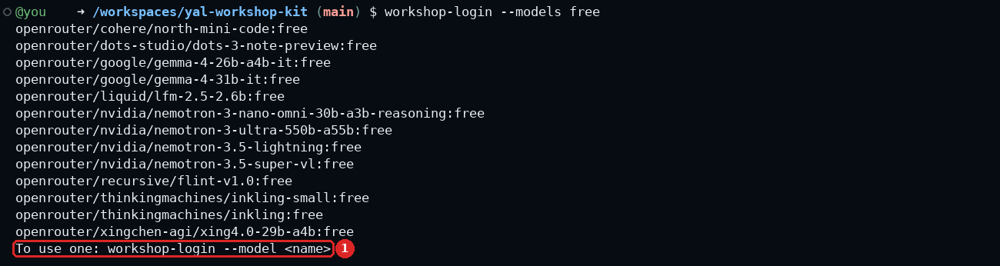

This list says what exists, on 2026-11-01. Read it with
[Free models](#free-models): a group cannot rely on them.

What is already running keeps the old model. Close the chatbot and start it again, or type
`openwebui start`. No line tells you this when only the model changes.

A new key goes back to the default model, unless `--model` names one. An Anthropic key pasted after
an OpenRouter key also goes back to Claude Code, unless you chose OpenCode with `--engine`. If Open
WebUI is running, you see `Open WebUI keeps the old key until you type: openwebui start`.

### The commands of this guide

This table is the short version of this part, to keep at hand during a session.

| Command | What it does |
|---|---|
| `workshop-login` | Saves a key and tests it. If you paste nothing and press Enter, it keeps the saved key. |
| `workshop-login --models` | Lists the models of your key's provider that can use tools. |
| `workshop-login --models openrouter` | The same list as `--models` with an OpenRouter key. Some messages ask for it. |
| `workshop-login --models free` | Lists the free ones. |
| `workshop-login --model <name>` | Chooses the chatbot's model. It does not change the judge or the sorter. |
| `workshop-login --europe` | Turns on the rule of [Part 8](#required-hosted-in-europe). |
| `workshop-login --no-europe` | Removes that rule. Never during a session with young people. |

---

## Before and during a session

No group has run this yet. What follows comes from OpenRouter's documentation and from our measures,
and the timing is our advice: no source gives a number.

### Before the session: prepare the account

Buy during the week before, once the session is sure. A purchase needs at least one working day:
credits can take an hour to appear, a card can be declined, and support on the Standard plan is by
e-mail, with no response time stated. After 24 hours the refund closes, so if the date may move,
wait before you pay.

A new account needs the most care. OpenRouter limits the money held by running requests on accounts
with a low balance and, for now, on newer accounts. A new account with a tight balance and a full
room is the worst case, so keep your margin and test ahead.

**The week before:**

- [ ] Credits are on the Credits page: pairs times the limit, plus a margin. The bill adds the fee
  and the taxes.
- [ ] The low balance alert is set, and the deprecation alert is on.
- [ ] There is one key per pair, named, with a credit limit and an expiry date.
- [ ] One key gives `Key OK` in a Codespace.
- [ ] You read the page of the model you will use
  ([how](#read-a-model-page-before-you-trust-it)).
- [ ] With young people: your data protection contact has answered, and you hold written parental
  consent ([Part 8](#part-8---data-and-young-people)).
- [ ] With young people: the keys stay with the adults, and no young person creates or uses their
  own key ([Part 8, item 1](#what-no-setting-removes)). Your organisation decided, knowing that this
  reading of the 18+ rule comes from OpenRouter's support chat, not from its terms. `--europe` does
  not lift this rule.

**The day before:**

- [ ] Decide what you will tell the pairs: with the default model, type only invented or public
  questions, never something real about a person. 5 of its 17 companies keep the questions, and
  nobody read the terms of the 17 ([Part 8](#what-each-companys-terms-say)).
- [ ] Type `workshop-login`. When it asks for the key, paste nothing and press Enter: you must see
  `Key OK`. A model that OpenRouter retired gives another line: `no company can serve the model` if
  it is still in the public list, `OpenRouter has no model` if it left the list. OpenRouter's
  documentation does not say which one comes. A new price gives no message at all: OpenRouter keeps
  serving the model and charges the new rate.
- [ ] Type a short `replay`, such as `replay D 8 11`. `workshop-login` sends one tiny request, and a
  chatbot that uses tools behaves differently.
- [ ] Read the page of the model again: price, companies, window. These can change.
- [ ] Check that the balance still covers the session.
- [ ] Prepare the keys in private messages or on paper. None goes in a slide.
- [ ] With young people: `workshop-login --europe` shows `hosted in Europe`
  ([Part 8](#required-hosted-in-europe)).

**On the morning of the session:** look at OpenRouter's [status page](https://status.openrouter.ai/).

We found no list of countries that OpenRouter blocks. Section 5.7 of the terms says that some model
companies refuse some countries or entities, and that going around this with a VPN or a proxy (tools
that hide where you connect from) is a serious breach of the terms. So do not. A Codespace runs in a data centre, so the country seen may not be the
country of your room (our inference). Nothing we read blocks France, Spain, Italy or Belgium, but no
session has run there yet (not tested).

### During the session

Keep OpenRouter's pages on your own screen, not on the projected one. No command shows a pair the
money left on its key, so you follow it yourself.

The quickest view is the [API keys](https://openrouter.ai/keys) page: **Key usage** against **Key
limit**, for each pair. For more, open [Activity](https://openrouter.ai/activity).

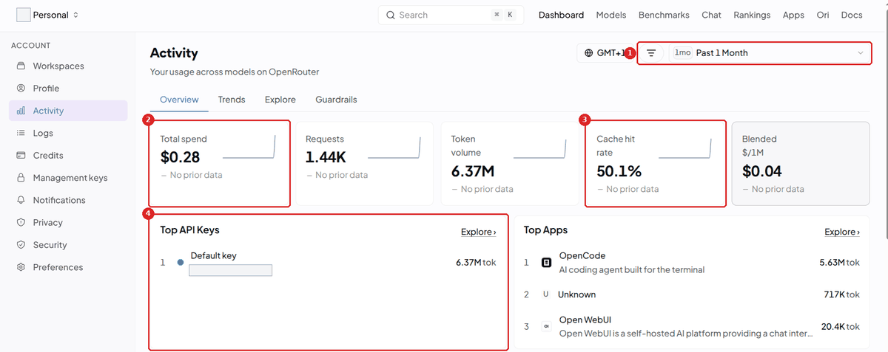

Its **Overview** tab shows **Total spend** (frame 2) and **Top API Keys** (frame 4). You can ignore
frame 3 during a session. To read what one pair spent, click the filter icon (frame 1), choose **API
Key**, then the key.

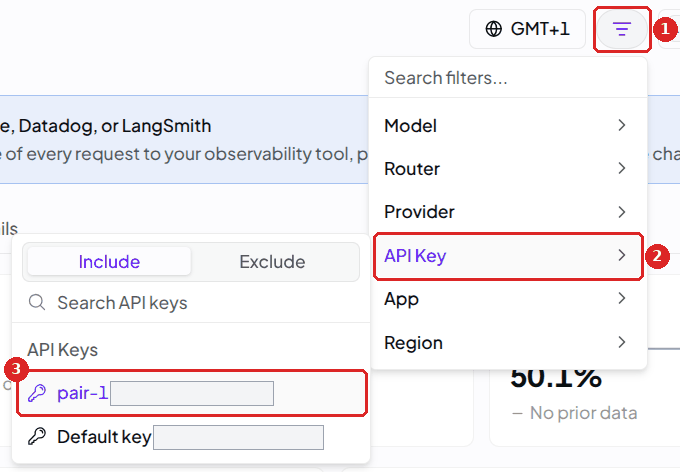

For one request at a time, open [Logs](https://openrouter.ai/logs): one row per answer, with model,
company, status and API key. A row opens with its cost and tokens. By default, these pages show no
text of the questions. Keep it that way ([Part 8](#optional-the-same-rule-for-the-whole-account)).

A pair that runs out has reached its limit, or the account is empty: see
[402](#402-no-credits-or-a-limit). Credits added during a session can take up to one hour to appear,
which is the reason for the margin.

A key that leaks needs action, even if nobody used it yet. A key that was shown on the projected
screen counts as leaked (our reading). OpenRouter scans GitHub for keys and sends an e-mail when it
finds one, but its documentation does not say that it disables the key for you. The credit limit
bounds the damage, and you pay what the key spent.

1. On the [API keys](https://openrouter.ai/keys) page, note the **Key usage** of that key: it is what
   the key has spent so far.
2. Open [Security settings](https://openrouter.ai/settings/security), tab **Key safety**, and choose
   **Archive** on that key. This is permanent, and you type `archive` to confirm. OpenRouter's advice
   for a leak is to "delete the compromised key and create a new one", and archiving is what its
   other pages call deleting. Do not stop at **Disable**: this tab no longer shows a disabled key, so
   you could not archive it from there afterwards. Nobody has archived a key with this guide yet (not
   tested).
3. Make a new key as in [Part 3](#part-3---one-key-per-pair).
4. In the Codespace of the pair, type `workshop-login` and paste the new key. Close the chatbot and
   start it again, or type `openwebui start`.
5. Open Activity and filter on the old key, to see what it did. Whether an archived key stays in this
   filter is not confirmed, which is the reason for step 1.
6. Write to <support@openrouter.ai>: the terms ask you to report a compromise promptly.

### After the last session

A key with a limit that never resets stays usable until its expiry date, or until you remove it. The
limit protects the money, not the access. So close each key on the
[Security settings](https://openrouter.ai/settings/security) page.

1. For your project budget, open Activity, tab **Explore**, group the spending by API key, and
   download it as CSV or PDF. Do this first: whether archived keys keep their names in Activity is
   not confirmed. OpenRouter describes this click in two ways, so it may differ (not tested). As we
   read it, with names such as `pair-3-aix-2026-11`, this report holds no personal data. Nobody has
   opened an export yet, so look at yours before you send it on.
2. In the tab **Key safety**, select the keys of the pairs and choose **Archive**. This is permanent,
   and you type `archive` to confirm. Other pages of OpenRouter call this deleting a key. Nobody has
   archived a key with this guide yet (not tested).
3. In the tab **Overview**, read the four cards: **No spend limit**, **Never expires**, **Never used
   or idle 90+ days**, **Safe to remove**. Each one shows keys that you may have forgotten.

---

## Part 5 - The tools

The commands do not change with the key, but the models behind them do. This table is what to read
when someone asks which model answered.

| Tool | With an Anthropic key | With an OpenRouter key |
|---|---|---|
| `workshop`, `replay` | Claude Code, `claude-sonnet-5-5` | OpenCode, `deepseek/deepseek-v4-flash`, or your `--model` |
| `score` (the judge) | `claude-haiku-5-5` | `deepseek/deepseek-v4-flash` |
| `openwebui`, kit mode (`replay RAG` included) | `claude-sonnet-5-5` | `deepseek/deepseek-v4-flash`, or your `--model` |
| `openwebui`, class mode | `claude-sonnet-5-5` and the cheaper `claude-haiku-5-5` | `deepseek/deepseek-v4-flash`, and `mistralai/mistral-small-3.2-24b-instruct` as second model |
| `./sorter compare` (workshop 6) | `claude-haiku-5-5` | `mistralai/mistral-small-3.2-24b-instruct` |

`./sorter claude` still works as another name for `./sorter compare`. With an OpenRouter key, it
does not call Claude. With `workshop-login --europe`, the last column changes: the chatbot and the
first model of class mode are `mistralai/mistral-small-2603`, and the judge, the second model and the
sorter are `mistralai/mistral-small-3.2-24b-instruct` ([Part 8](#required-hosted-in-europe)).

Four things differ from an Anthropic key. With OpenCode, no shell command runs without asking, so
the chatbot searches with OpenCode's own `read`, `grep` and `glob` tools. `replay` runs in a copy of
the kit without the test material.

OpenRouter would send a question to any company that serves the model, so the kit adds
`data_collection: deny` to every request. This leaves out companies that may collect the data or
train on it. Some of the others keep the questions
([Part 8](#what-zero-data-retention-means)).

OpenRouter writes the cost of each request in its answer. From OpenCode 2.2.5 on, `replay` shows
this cost. OpenCode 2.1.4 ignores it and works the cost out from the price of the model, when it
knows that price. With no cost and no price, `replay` prints `cost: not known`. `replay RAG` prints
`cost: not shown by Open WebUI`.

---

## Part 6 - The models on 2026-11-01

You can run a session without reading this part: the defaults are chosen. Read it before you change
a model, and to learn why the defaults are these.

These results are one day's measures, and the prices and quotas of OpenRouter change. A mode is one
stage of the chatbot in the workshops: `bare` is the model alone, A has its instructions, B all its
knowledge at once, C searches the documents, D adds outside tools, E adds a wiki. Modes bare, A, C,
D and E ran on 11 questions (22 points), and B on 3 (6 points).

| Model | bare | A | B | C | D | E | Empty or failed answers | What must be paid |
|---|---|---|---|---|---|---|---|---|
| `deepseek/deepseek-v4-flash` | 2/22 | 11/22 | 6/6 | 20/22 | 19/22 | 19/22 | 0 | credits |
| `mistralai/mistral-small-3.2-24b-instruct` | 10/22 | 8/22 | 4/6 | 16/22 | 14/22 | 14/22 | 0 | credits |
| `mistralai/mistral-small-2603`, at `mistral/eu` alone | not run | not run | 3/6 | 15/22 | 4/4, 2 questions | not run | 0 | credits |
| `google/gemini-2.5-flash-lite` | 10/20 | 12/22 | 5/6 | 12/20 | 1/2 | 9/16 | 8 of 51 | credits |
| `google/gemma-4-26b-a4b-it:free` | 8/22 | 12/22 | stopped | stopped | stopped | stopped | 429 from C on | nothing, inside the quota |
| `cohere/north-mini-code:free` | stopped | stopped | stopped | stopped | stopped | stopped | 429 on 17 of 18 answers | nothing, inside the quota |

Read this table as a rough guide. The scores come from a machine judge (`claude-haiku-5-5`) and from one
run, and no person checked them. One score does not rank two models: on a second run of mode D, the
same judge gave DeepSeek v4 Flash 22/22 instead of 19/22, and two runs of one model differed by up to
3 points of 22. A total below 22 means that fewer answers got a score. "Stopped" means that `replay`
stopped after three errors in a row: these two lines do not score the free models. `mistral/eu`
means Mistral's own service in Europe, the one for young people. The line of `mistral-small-2603` is
the only one pinned to it. In B its questions were 3, 7 and 10, where the line of Mistral Small 3.2
used other questions.

These are OpenRouter's figures on 2026-11-01 for what you pay and for the **window**, how much a
model reads at once. ZDR, zero data retention, is explained in
[Part 8](#what-zero-data-retention-means).

| Model | Price in/out, per million tokens | Window | Companies under ZDR | In Europe |
|---|---|---|---|---|
| `deepseek/deepseek-v4-flash` | about $0.09/$0.18 in the list, see below | 1M | 12 of 17 | none |
| `mistralai/mistral-small-3.2-24b-instruct` | $0.075/$0.20 at the cheapest company, $0.10/$0.30 in Europe | 128k to 256k, 32k in Europe | 4 of 4 | 1 |
| `mistralai/mistral-small-2603` | $0.165/$0.66 in Europe | 262k in Europe | 3 of 4 rows, all Mistral | 1 |
| `google/gemini-2.5-flash-lite` | $0.10/$0.40 | 1M | 0 of 1 (55 days) | none |
| `google/gemma-4-26b-a4b-it:free` | free | 262k | 0 of 1 (55 days) | none |
| `cohere/north-mini-code:free` | free | 256k | 0 of 1 (30 days) | none |

Each company sets its own price, so one model has many. For `deepseek/deepseek-v4-flash`, $0.09/$0.18
is OpenRouter's list of models and the row of DeepInfra. The model page shows $0.05/$0.45 at the top,
the row of Relace, and other rows reach $0.44/$1.32 at Cloudflare or $0.60/$0.17 at Wafer. The kit
saves the price of the list. With OpenCode 2.1.4, the cost that `replay` shows comes from this
price: it is an estimate. From OpenCode 2.2.5 on, `replay` shows the cost that OpenRouter wrote in
each answer (all 252 answers of our four runs in Europe, on 2026-11-01, had one). The Activity page
shows what you really paid.

### Why these defaults

DeepSeek v4 Flash scored highest in modes C, D and E with no failed answer, and as judge it left one
answer without a score, against 27 for Gemini 2.5 Flash Lite. That is one run: a rough guide, not a
ranking. The cost is time: 3 to 4.5 minutes for a `replay` of 11 questions in bare, C, D and E,
against 32 to 53 seconds for Mistral Small.

Mistral Small sorted all 32 test messages and missed no urgent one, so it is the sorter. It is also
the second model of class mode. With `--europe`, the chatbot is `mistral-small-2603`: Mistral Small
3.2 cannot run mode B there, and this model can. The tables behind these choices are in
[Part 9](#notes-on-the-measures).

### Read a model page before you trust it

`workshop-login --model` tests one short request and says nothing about price, window or data. The
model's page says all three, asks for no account, and takes a minute to read. It declares a policy
and proves nothing, as [Part 8](#what-zero-data-retention-means) explains.

1. Open the [list of models](https://openrouter.ai/models) and search the name that the commands use,
   because the website shows another title. `mistralai/mistral-small-2603` has the title "Mistral:
   Mistral Small 4", and `deepseek/deepseek-v4-flash` has the title "DeepSeek: DeepSeek V4 Flash
   0423". The name is under the title. To browse, open **Supported parameters** and check **tools**:
   the commands only keep these models.
2. Read the boxes at the top: **IN / OUT PRICE**, per million tokens, and **CONTEXT**, the window.
   This price is one company's, not what you will pay.
3. Read the **Providers** table. Each row is one company running this model, with its own price and
   speed. The order changes at each visit. The site labels the green shield "Private" and the amber
   one "Logs".
4. Click a row. A panel opens with **Region** and **Data policy** (**Prompt training**, **Retention**,
   **ZDR compatible**). [Part 8](#what-zero-data-retention-means) shows two of them. Read the row of
   the company and not the model: two rows of one model can differ.
5. Read **Uptime** in the same row. The Uptime section of the page counts the past 3 days and only
   needs one company to answer, so it says nothing about one chosen company.
6. Then test it for real: `workshop-login --model <name>`, and a short `replay`.


Frame 2 is the row of Relace, not a price for the model. Frames 4 are the companies to think about
when you read the list of the default model in [Part 8](#what-each-companys-terms-say).

To taste a model before a session, [Chat](https://openrouter.ai/chat) on the website sends one prompt
to one or more models, side by side, and **Try this model** opens it from the model's page. It takes
money from your credits, and the conversations stay on your device. Use invented questions only. It
does not go through the commands of the kit, so it does not carry their rule on data, and it is no
test of `--europe` (our inference). Your account's privacy settings do apply to it.

### Free models

**A group cannot rely on free models.** Nobody has tried them with a whole group. OpenRouter's
[limits](https://openrouter.ai/docs/api_reference/limits) allow 20 requests a minute, and 50 requests
a day, or 1,000 a day once the account has bought at least $10 of credits (a day is a UTC day).
Failed attempts count in the daily cap, and a negative balance blocks free models. More keys give a
group no more: "Making additional accounts or API keys will not affect your rate limits". The same
sentence goes on: "We do however have different rate limits for different models".

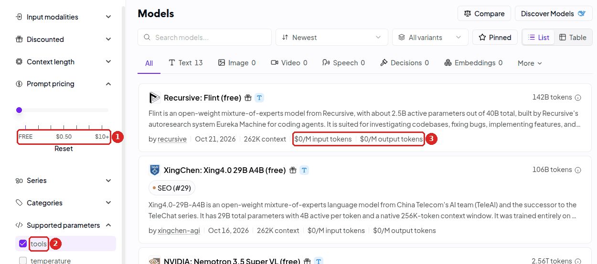

These two filters give 13 models, like `workshop-login --models free`, with no account. OpenRouter
had 14 free models that day: the 14th cannot use tools.

In one test, `cohere/north-mini-code:free` used 60 to 62 requests for one `replay C`, about 5.5 per
question. That is more than the 50 requests a day of an account that has not bought $10 of credits.
With two free models at the same time, both ran into 429. Do not rely on the counter
`Free requests left today` during a session ([Part 9](#notes-on-the-measures)).

Do not use `openrouter/free`. This special name picks a free model at random, so the company, and
with it the data policy, changes between requests. Nobody has tried it with `workshop-login --model`
(not tested).

For the data of free models, read [Part 8](#part-8---data-and-young-people) first. On 2026-11-01,
the pages of OpenRouter marked 8 of the 14 free models as training on data. Only one of the 14 kept
nothing.

Leave out three models of the free list. `inkling` and `inkling-small` answered 403 on any direct
call, and their terms forbid children's data. `nemotron-3.5-super-vl:free` has no company under the
rule of the kit.

### Paid models

The [limits](https://openrouter.ai/docs/api_reference/limits) page, read on 2026-11-01, describes
OpenRouter's rate limits as "free-model request caps and DDoS protection". It says that the paid
variant of a model "has no platform-level request cap". So a 429 on a paid model should come from
the company that runs it, not from OpenRouter. Nobody has seen a real 429 on a paid model yet (not
tested).

With `workshop-login --europe`, Mistral alone serves the model and there is no second company. A 429
from Mistral reaches the group directly ([Part 7](#429-too-many-requests)).

---

## Part 7 - When a request fails

Each error has its own number and its own remedy, and the tools print the number. Find it below,
read what your tool prints, and follow the steps. The steps come from the messages of the tools and
from OpenRouter's documentation. A real 429 in a session and a small real balance are (not tested).

With `workshop` and Open WebUI, the pair does not see the lines below: OpenCode and Open WebUI use
their own screens (not tested). If a pair says the chatbot stopped answering, look at the
[Credits page](https://openrouter.ai/settings/credits) and at [Logs](https://openrouter.ai/logs) on
your own screen, then find the number here.

### 429: too many requests

| Tool | On screen |
|---|---|
| `replay` | `ERROR: too many requests, or the quota of this key or of this model is used up (429: <details>). Wait a minute, then try again.` After three in a row: `Three errors in a row: stopping.` |
| `score` | `Judge unavailable: HTTP 429: <details>.` If OpenRouter asks for more than 60 seconds: `Judge stopped: OpenRouter asks to wait <n> seconds. You score alone for this run.` |
| `./sorter compare` | `<model> is busy (HTTP 429): <details>. Wait a minute and type ./sorter compare again.` |
| `workshop` | OpenCode's own screen (not tested) |
| Open WebUI | (not tested) |

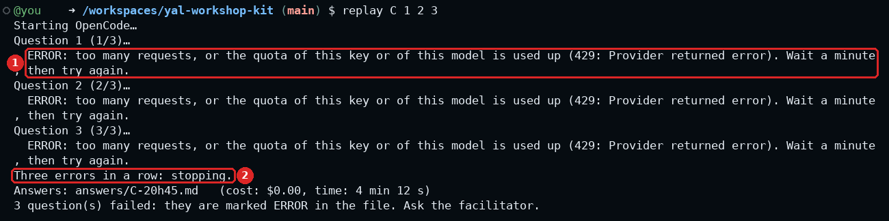

The words in brackets are the ones OpenRouter sent. This test picture uses a message measured on a
real free model.

OpenCode tries a 429 or a 503 again by itself before it shows the error, so the screen can look
stuck. This took 82 to 93 s on a fake OpenRouter. In a real run, three 429s came within 10 s: the
wait varies. With `workshop` or Open WebUI, if nothing comes, wait a minute and try again. If it
stays, the facilitator changes the model with the steps below.

During the session:

Look at the model name. After a `replay`, it is in the line `Engine:` of the answers file. Otherwise,
type `workshop-login`. When it asks for the key, paste nothing and press Enter: the last line names
the model. Then follow the one case that fits, reading from the top.

- **`--europe` is on:** wait a minute and try again. If it still fails, change to the other Mistral
  model: the rule stays the same, and Mistral serves both. With
  `workshop-login --model mistralai/mistral-small-3.2-24b-instruct`, mode B stops running
  ([Part 8](#required-hosted-in-europe)). To go back, type
  `workshop-login --model mistralai/mistral-small-2603`. Do not type `--no-europe` during a session
  with young people.
- **It ends with `:free`:** stop using it for this session. Trying again uses up the day's quota.
  Move the pair to a paid model. When the command asks for the key, paste nothing and press Enter:

  ```bash
  workshop-login --model deepseek/deepseek-v4-flash
  ```

- **It is a paid model:** wait a minute and type the same command again. If it still fails, choose
  `mistralai/mistral-small-3.2-24b-instruct` with `workshop-login --model`.
- **Many pairs at once:** let them start `replay` one after the other, or on a few questions:
  `replay D 8 11`.

In class mode, your chatbots do not come back with the model: they stay on Mistral Small 3.2, and
`openwebui start` names them. For each one: **Workspace → Models**, open the chatbot, choose
`mistralai/mistral-small-2603` in **Base Model (From)**, and click **Save & Update** (this move: not
tested).

After a change of model, close the chatbot and start it again, or type `openwebui start`. `--model`
does not change the judge or the sorter: with `score` or `./sorter compare`, wait a minute and try
again.

### 402: no credits, or a limit

| Tool | On screen |
|---|---|
| `replay` | `ERROR: no credits left on this key (402: <details>). Add credits on the provider's website, or ask the facilitator.` |
| `score` | `Judge stopped: no credits left on this key (<details>). You score alone for this run.` |
| `./sorter compare` | `OpenRouter says this account has no credit left: <details>. Show this message to the facilitator.` |

A 402 has three possible causes. Look at the balance on the
[Credits page](https://openrouter.ai/settings/credits) first.

If the account is empty, add credits. On 2026-11-01, OpenRouter let $0.17 of overdraft through, then
answered 402.

If money is left and only this key is stopped, the key is at its limit: raise the limit on the
[key's page](#at-the-limit).

If the balance is small, on a prepaid or recent account, the cause can be OpenRouter's hold. It holds
an estimated cost in advance, so a request can fail while the balance is still positive. Wait a
minute and try again, and do not run many pairs at once on a small balance. Adding credits helps, up
to a ceiling. This does not apply to free models.

### 403: a limit, or a rule of yours

| Tool | Spending-limit line | Refused line |
|---|---|---|
| `workshop-login` | `Key saved, but this key has reached its spending limit. Tell the facilitator.` | `Key saved, but the test answered HTTP 403 (model <name>): <details>. Tell the facilitator.` |
| `replay` | `ERROR: this key or its account reached a spending limit (403: <details>). Raise the limit on the provider's website, or ask the facilitator.` | `ERROR: the key was refused (403: <details>). Check it: workshop-login` |
| `score` | `Judge stopped: a spending limit stopped this key (<details>).` | `Question <n>: judge unavailable: the key was refused (HTTP 403): type workshop-login.` |
| `./sorter compare` | `A spending limit stopped the test: <details>. Show this message to the facilitator.` | `OpenRouter refused the request (HTTP 403): <details>. Check your key with workshop-login. If the key is right, show this message to the facilitator.` |

The tools choose the line from the words OpenRouter sent, so always read the words in brackets. The
spending-limit line comes when they contain `limit`, `budget` or `guardrail`. The refused line comes
for the rest.

**Spending-limit line.** The likeliest cause is the key's own credit limit, because every key has one.
OpenRouter's documentation gives the words `Key limit exceeded`. Raise **Credit limit** on the
[key's page](#at-the-limit). If the key is under its limit, look for a
[workspace budget](#optional-one-ceiling-for-the-whole-group): the words then name the workspace.

If the words speak of a guardrail or a data region, no money is involved. A
[guardrail](#optional-a-rule-held-by-openrouter) of yours refused the request, and the tool says
"spending limit" only because it found the word. Change the guardrail, not the limit.

**Refused line.** It blames the key, and the key may be fine. If the words speak of a model, a
company, a block or a rule, a guardrail of yours refused the request: change the guardrail or the
model, not the key.

`replay` has a third line, for words such as `moderation` or `flagged`:
`ERROR: the company that runs the model blocked this text (403: <details>). Change the question, or
ask the facilitator.`

We saw the two columns with a fake OpenRouter on 2026-11-02, with words
copied from OpenRouter's documentation. What the real one writes when a guardrail refuses a company is
(not tested).

### 503: busy, or no company

| Tool | On screen |
|---|---|
| `replay` | `ERROR: the model is busy, or no company can serve it now (503: <details>). Try again later, or ask the facilitator.` |
| `./sorter compare` | `<model> is busy (HTTP 503): <details>. Wait a minute and type ./sorter compare again.` |
| `./sorter compare`, no company at all | `No company can run <model> for this test: <details>.`, followed by what to do |

Wait a few minutes. If it stays, choose another model with `workshop-login --model`. If you turned
on the settings of [Part 8](#part-8---data-and-young-people), they may leave no company for the
model: [read the model's page](#read-a-model-page-before-you-trust-it). With `--europe` on and young
people, wait, change to the other Mistral model as in [429](#429-too-many-requests), or stop the chatbot for this
session.

---

## Part 8 - Data and young people

> [!WARNING]
> **With young people and OpenRouter, type `workshop-login --europe`.**
>
> Requests then go only to Mistral, hosted in Europe, with zero data retention. The default model
> is `mistralai/mistral-small-2603`. This is the rule of the Youth AI Lab project with an OpenRouter key. In class mode,
> `workshop-login`, `openwebui start` and `openwebui share open` print it until it is on.
>
> **Stay with Mistral.** `--europe` allows Mistral alone, so any model it accepts stays with terms
> already read. Other companies run models in Europe, but the terms of Amazon and Azure were not
> read, and Google's may exclude this use ([item 4](#what-no-setting-removes)). Mistral's were read,
> and they ask for parental consent ([item 5](#what-no-setting-removes)).
>
> It does not keep everything in Europe ([what it covers](#required-hosted-in-europe)), and it does
> not lift [what no setting removes](#what-no-setting-removes). Read both before you open anything
> to young people.

The workshops are for adults. This part is for the moment a chatbot opens to young people, such as
in the class mode of the Open WebUI guide. At the end, you know what to turn on, what each setting
covers, and what no setting removes.

This is not legal advice. It says what the texts said on 2026-11-01, plus the answer of
OpenRouter's support chat on its age rule ([item 1](#what-no-setting-removes)). The organisation decides, with
its data protection contact. Nothing here means that this setup is allowed for your group.

### What zero data retention means

OpenRouter's [definition](https://openrouter.ai/docs/guides/features/zdr): "Zero Data Retention
(ZDR) means that a provider will not store your data for any period of time." A company can promise
not to train on your data and still keep it. The panels of two companies show the difference.

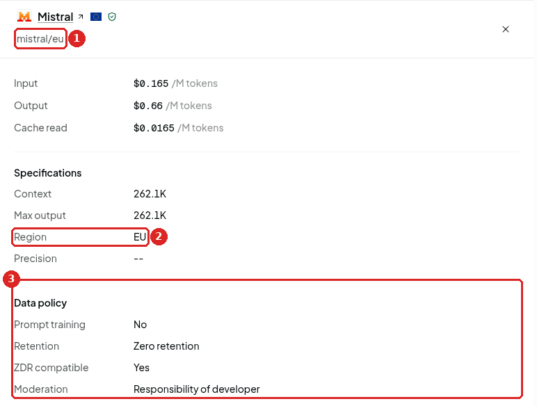

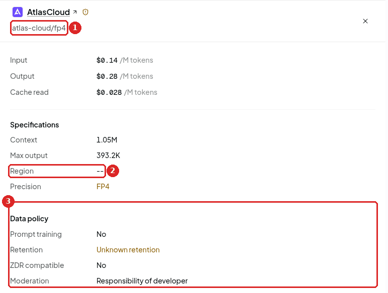

Compare **Retention** in the two frames 3: both say No to training, and only the first keeps nothing.
These panels are OpenRouter's list, not a proof. On the first, **Moderation** says "Responsibility of
developer". As we read this label, OpenRouter does not moderate requests to this company, that is, it
does not filter questions and answers for harmful content. The kit adds no filter either: the safety
rules of a chatbot live in its instructions.

The rule the kit always sends, `data_collection: deny`, does not give you ZDR. It only leaves out
companies that may collect the data or train on it. On 2026-11-01, Gemini 2.5 Flash Lite and
`google/gemma-4-26b-a4b-it:free` answered with this rule on, and the one company of each is listed
with 55 days of retention.

ZDR has limits, even when it is on. OpenRouter's list "reflects the AI Model Provider's published or
represented policy", and "does not constitute OpenRouter's guarantee of AI Model Provider
compliance." It covers the questions sent to a model, not add-ons such as web search: the kit keeps
web search off in Open WebUI. OpenRouter does not count a short-term copy in a computer's memory (a
cache) as retention. For each
request, OpenRouter keeps the number of tokens and the time taken, and "samples a small number of
prompts for categorization" (a prompt is a text sent to a model).

### Required: hosted in Europe

```bash
workshop-login --europe
```

When it asks for the key, paste nothing and press Enter. It keeps the saved key. In class mode, you
must see:

```text
Key OK (OpenRouter, model mistralai/mistral-small-2603, hosted in Europe). You can start: openwebui start
```

In the kit, you must see:

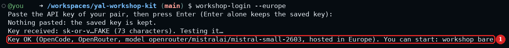

The words `hosted in Europe` are the ones to look for.

**Before `openwebui share open`:** type `openwebui start`. The line `Warning: with young people...`
must be gone. If you still see it, the rule is off.

From then on, `workshop`, `replay`, `score`, `openwebui` and `./sorter` send this with each request:
one European endpoint (`mistral/eu`), zero data retention, no second choice. An endpoint is one
company running one model in one place. If it cannot serve the model, the request fails.

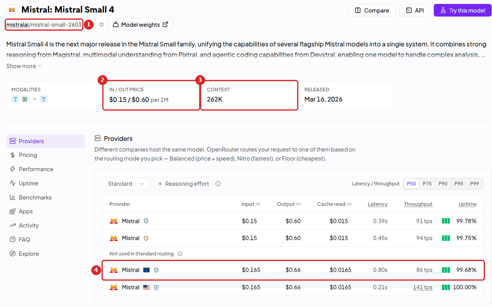

`--europe` uses the row of frame 4. The price of frame 2 belongs to the first rows. Frame 4 sits under
**Not used in Standard routing**: ordinary use does not reach it, and the commands ask for it by
name, so you pay its price.

> [!WARNING]
> **`--europe` chooses where the model runs, not where OpenRouter handles the request.** OpenRouter
> itself may handle a request elsewhere. The kit still sends every request to `openrouter.ai`, and
> has no option for `eu.openrouter.ai`. Accounts, billing and security logs may stay in the US in
> all cases.

The replies of OpenRouter named Mistral, and no region. The place comes from OpenRouter's list: no
call and no independent proof confirmed where a model runs. Class mode with `--europe` ran with a
real key, but only as far as one question to each base model, asked by the administrator: no group,
no phone, no real Codespace.

Read the first line of this table as what you have, and the second as what stays out of reach of the
kit.

| What you want | Ordinary account (Standard) | Business plan |
|---|---|---|
| A European company named inside each request: `workshop-login --europe` | yes: OpenRouter accepted it on 2026-11-01 | not needed |
| Requests sent to `eu.openrouter.ai`, handled and served only in Europe (EU and EEA, UK, Switzerland), with no fallback outside it | no: the pricing table gives it to the Business and Enterprise plans | yes, but the commands of the kit do not support it |
| A free model in Europe | none | none |

You move to the Business plan yourself, with no contract and no minimum. The fee is 8 % on credits
instead of 5.5 %, and you can go back only after 30 days.

For the European address, OpenRouter [writes](https://openrouter.ai/docs/guides/features/in-region-routing):
"There is no setting to turn on: once your account is on one of these plans, you choose the region
for each request by sending it to that region's base URL." Even there, only prompts and answers stay
in Europe. OpenRouter [writes](https://openrouter.ai/docs/guides/features/sovereign-ai): "Account,
billing, and other operational records may be stored or processed in the US." OpenRouter, Inc. is a
New York company, and the EU-only addendum of its data processing agreement applies only if chosen
in writing.

`--europe` was the setting. What follows is what it cannot change.

### What no setting removes

1. **OpenRouter's age rule.** The terms say: "You must be at least 18 years of age to use the
   Service." The [privacy policy](https://openrouter.ai/privacy) says: "This Site is offered and
   available to users who are 18 years of age or older." It has no exception for organisations or
   parental consent. Section 5.2 of the terms adds: "You will require that all of your Authorized
   Users and customers access and use the Service and Models only in accordance with this
   Agreement". No text says in so many words that an organisation may or may not offer a chatbot to
   minors. Asked through its support chat, OpenRouter answered that the rule forbids a young person
   to create and use their own key, and does not apply to young people supervised by a responsible
   adult. This reading is not written in its terms or its privacy policy (both last updated 31
   August 2026), and the date of the chat was not recorded. So keep every key with the adults, and stay with the group. If your organisation wants the
   answer in writing, ask <support@openrouter.ai>, or **Raise a Ticket** on its
   [Support](https://openrouter.ai/support) page.
2. **Sensitive data.** The data processing agreement lists health, origin, religion and criminal
   records, among others, and says: "No processing of Sensitive Data or any special categories is
   intended". Any such processing needs an amendment. As we read it, a chatbot where a young person
   writes about their health or their situation falls outside this frame without one. The
   agreement names "End Customers" and never mentions minors.
3. **The planned screening for child abuse material.** The
   [announcement](https://openrouter.ai/blog/announcements/csam-screening/) of 27 October 2026 says:
   "CSAM screening will also apply to requests covered by OpenRouter's Zero Data Retention (ZDR)
   policy." The ZDR page adds: "Content flagged as potential CSAM may be retained for human review,
   reporting, and preservation where required by law." The start date is not established. As we
   read it, for a group of minors, a false alarm could lead to retention and to a person reading the
   text, even under ZDR. The announcement says: "A flag indicates suspected material; it is not
   itself a determination that the content is CSAM".
4. **Google's clause on under-18s.** The
   [Gemini API terms](https://ai.google.dev/gemini-api/terms) say you "will not use the Services as
   part of a website, application, or other service" that "is directed towards or is likely to be
   accessed by individuals under the age of 18." The
   [Google Cloud terms](https://cloud.google.com/terms/service-terms) say the same for generative AI
   services and their end users. Whether this reaches a customer of OpenRouter through Vertex is
   not established.
5. **Mistral's clause on minors.** `--europe` sends everything to Mistral. Its
   [commercial terms](https://legal.mistral.ai/terms/commercial-terms-of-service/) forbid you to
   "include any personal information of children under 13 or the applicable age of digital consent
   as Customer Data or allow minors to use the Mistral AI Products without legally adequate consent
   from their parent or guardian". The young people of this project are 12 to 15, so this applies to
   them directly. The age of digital consent is the age from which a young person can agree alone to
   an online service. It is set by country: ask your data protection contact. As we read the clause:
   no personal information of a child under that age goes in the chatbot, and you get written
   parental consent before any minor uses it. Whether this text reaches a customer of OpenRouter is
   not established: follow it anyway.

### What changes when `--europe` is on

Turning the rule on moves you to `mistralai/mistral-small-2603`. After that, `--model` can name
another Mistral model, and it stays. If Mistral does not serve it, the command says so and names a
model that works.


These filters show the Mistral models with a row in Europe, but `--model` decides whether Mistral
serves one. Do not trust the cards: Mistral Small 3.2 shows 256K and $0.075, where `mistral/eu` gives
32k and $0.10. Without the search on `mistral`, the EU filter also shows other companies, which
`--europe` refuses.

The window, how much a model can read at once, changes the most. `mistral-small-2603` has 262k tokens
at `mistral/eu`. Mistral Small 3.2 has 32k there, against 128k to 256k at the three other companies,
none listed in Europe. Nobody has tried a class-mode chatbot with a long conversation in 32k (not
tested).

Mode B sends the whole kit at once. It runs with `mistral-small-2603`
([Part 6](#part-6---the-models-on-2026-11-01)). With Mistral Small 3.2 at `mistral/eu` it failed
before the model's first word (measured on 2026-11-01). The commands refuse mode B for any model with too
small a window, with `--europe` or without it:

```text
Mode B sends the whole kit at once, and this model reads 32,768 tokens at most.
This mode cannot run with it. Choose a model with a larger window: workshop-login --model mistralai/mistral-small-2603
```

Without `--europe`, the line ends with `workshop-login --models openrouter`.

Only the line of `mistral-small-2603` in [Part 6](#part-6---the-models-on-2026-11-01) was pinned to
`mistral/eu`: the other scores are not scores in Europe.

The usual judge has no company in Europe, so `score` moves to Mistral Small 3.2, and
`./sorter compare` stays on it. Its 32k window is enough for a judge (measured on 2026-11-01). It
agrees less often with our reference judge than the usual judge does: 75 % against 83 %
([Part 9](#notes-on-the-measures)). In class mode, you have two base models: `mistral-small-2603`,
and the cheaper Mistral Small 3.2 as the second one. A chatbot on the second one stays on it.

With OpenCode 2.1.4, the cost shown can be too low, for the reason given in
[Part 6](#part-6---the-models-on-2026-11-01): the kit saves the price of the list, and at `mistral/eu`
a model costs more. From OpenCode 2.2.5 on, `replay` shows the cost that OpenRouter reports.

Turn the rule on first, then start the rest: what is already running keeps the old rule
([what each message means](#what-each-message-means)).

`--europe` stays on at your later logins. `workshop-login --no-europe` removes it, and so does a key
of another provider.

### The other models of Part 6

OpenRouter lists no company in Europe for `deepseek/deepseek-v4-flash`, the default, or for
`google/gemini-2.5-flash-lite`, and none under ZDR for Gemini. The companies are listed under
[What each company's terms say](#what-each-companys-terms-say).

### What each company's terms say

These are each company's own terms for the product named. The same company reached through
OpenRouter can differ: OpenRouter's pages declare a policy for each row of a model, and its agreements
with these companies are not public.

| Company and product | Minors | Training | Retention | Place |
|---|---|---|---|---|
| **DeepSeek**, its own services | "primarily intended for adults"; under 18 with a guardian's consent; no chatbot "designed to specifically appeal to or present a persona of any person under the age of 18" | may use inputs and outputs, de-identified; OpenRouter lists DeepSeek's own row as training | as long as the account exists, no number of days | China |
| **Mistral**, API and Studio | no personal information of children under 13 or the age of digital consent; minors need "legally adequate consent from their parent or guardian" | no, unless you agree to it; feedback, an order form, and Labs or Preview models are exceptions | 30 rolling days, unless ZDR; OpenRouter lists no retention on `mistral/eu` | EU by default; temporary transfers possible, depending on the feature |
| **Google**, Gemini API and AI Studio | 18 or older, and see [item 4](#what-no-setting-removes) | paid services: no; in the EEA, Switzerland and the UK, the same rules for free services | 55 days | "any country in which Google or its agents maintain facilities" |
| **Google**, Vertex | see [item 4](#what-no-setting-removes) | not without the customer's permission | flagged prompts, up to 90 days | the `eu` address stays in EU member states |
| **Cohere**, free model of Part 6 | "not intended to be used by minors (children)"; its usage policy asks an application used by minors for added safety controls | trial keys: may be used for research and development | 30 days, unless flagged | Google Cloud, US-Central, in an undated FAQ |

The default model does not reach DeepSeek itself. OpenRouter lists 17 other companies for it. Under
ZDR: Relace, DeepInfra, Venice, DigitalOcean, Fireworks, SiliconFlow, Crusoe, Parasail, Mancer 2,
Azure (in the US), Cloudflare and Wafer. Keeping the questions: StreamLake, Baidu, GMICloud,
AtlasCloud and Alibaba.

**The terms of these 17 companies were not read.** So the default model is for adults only, with
invented or public questions.

### Optional: the same rule for the whole account

You do not need this step. `workshop-login --europe` already asks for ZDR in each request of the kit.
These settings hold ZDR for the whole account, whatever tool uses the key, the website's Chat included.
Nothing in this guide was run with them on.

1. As the account holder, open the [privacy settings](https://openrouter.ai/settings/privacy), under
   **Privacy** in the menu of the account.
2. Under **Zero Data Retention**, turn on each toggle: **All other models** (frame 1), **Anthropic**,
   **OpenAI**, **Google** and **SpaceXAI**. DeepSeek and Mistral are not in the last four, so **All
   other models** is the one that matters here (our reading). "Enabling a scope restricts all your
   requests to ZDR endpoints for that model group."
3. Choose **Zero retention only** (frame 2). Without a choice, an ordinary account stays on **Safety
   retention allowed**: Google may then keep questions that its automatic filters flag, for up to 90
   days. OpenRouter warns that with **Zero retention only**, "Most Google models become unavailable."
   Click **Save changes** (frame 3).

   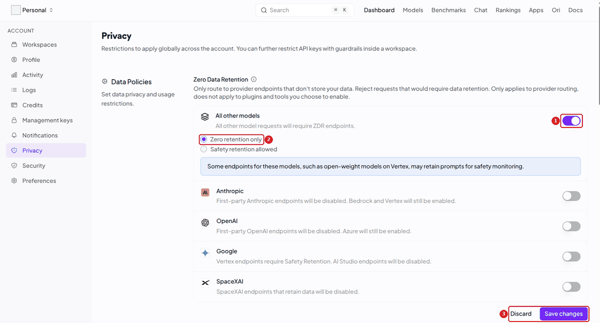

4. Lower on the same page, under **Data Training**, leave the four switches off (frame 1). They allow
   paid companies that train on your data, free companies that do, free companies that publish
   prompts, and **Allow 1% data discount in workspaces**. The last one lets a workspace agree that
   OpenRouter uses your inputs and outputs: the documentation calls it **OpenRouter Use of
   Inputs/Outputs**. OpenRouter stores your prompts only if you opt in, or if they are flagged as
   potential child abuse material. Section 6.2 of the terms attaches a licence to prompt logging that
   includes the right to "license or sell your User Content in anonymized form".

   

   You do not need frame 2: each key already has its own date. Frame 3 is the Business plan of
   [the table above](#required-hosted-in-europe).
5. Open the [Observability settings](https://openrouter.ai/settings/observability) of each workspace.
   Leave **Input & output logging** off (frame 1, in beta on 2026-11-02). Once on, it stores the text
   of the questions for at least 3 months, and you and any admin could read what the pairs wrote.
   Add nothing under **Traces** (frame 2), which the documentation calls Broadcast: it sends your
   data to an outside tool. The **Activity** page may show a banner with **Connect a tool**: it
   leads to the same thing, so leave it alone.

   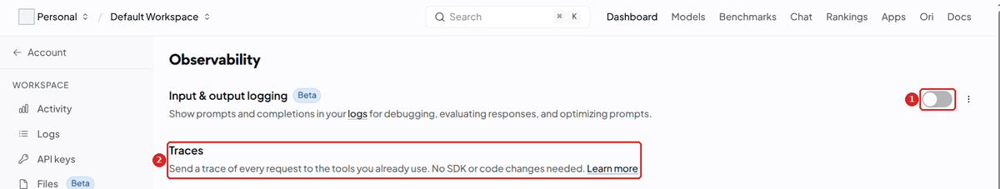

6. In the Codespace, type `workshop-login`. When it asks for the key, paste nothing and press Enter.
   You must see `Key OK`: a company can serve the model, and the line does not say which one. If you
   see `no company can serve the model`, choose another model.

To check by hand after `--europe`, open [Logs](https://openrouter.ai/logs), filter on one key, and
read the company on a few rows. Nobody has checked what a row shows as data region for `mistral/eu`
(not tested).

### Optional: a rule held by OpenRouter

The rule of `--europe` lives in your Codespace, so a `workshop-login --no-europe` typed by accident
removes it. A **guardrail** is a rule that OpenRouter holds for a key, on its side. It adds to
`--europe` and replaces nothing, and it lifts none of [what no setting removes](#what-no-setting-removes).
Mistral also has rows outside Europe, so a guardrail on Mistral alone does not replace `--europe`.
No guardrail was tried with this guide. On 2026-11-02, a personal account has a **Guardrails** entry
in its menu, and the list of keys has a **Guardrails** column, but nobody has opened that page.

1. Open the **Guardrails** page of your
   [workspace](https://openrouter.ai/workspaces/default/guardrails) and click **New Guardrail**.
2. Set the **Provider allowlist** to Mistral. Whether it can name `mistral/eu` alone is not confirmed.
3. Read the eligibility preview: it shows the companies and models that remain.
4. Save, then assign the guardrail under its **API Keys** section. A guardrail enforces nothing until
   it is assigned, and a key takes one guardrail only.
5. Test each key with `workshop-login` before the session. A refusal may look like a problem with the
   key, or like a spending limit ([403](#403-a-limit-or-a-rule-of-yours)).

The same page offers a **Sensitive Info** filter. Do not count on it to protect young people. It
scans the questions and not the answers, its person names and addresses are in beta, and if the
check times out, the request passes. Its accuracy in French, Catalan, Italian or Dutch is not stated.
At most, it is one more net, and never a reason to let young people type personal data.

The facts of this part were collected by AI models and then checked by a second one, against the
raw pages. No lawyer read them. If your organisation says no, a model on its own machine sends
nothing to these companies: see the
[local AI guide](https://github.com/Youth-AI-Lab/yal-local-ai-guide).

---

## Part 9 - Sources and status

Where each fact comes from, what was run, and what nobody has run yet.

### Sources, read on 2026-11-01

- OpenRouter, rules and prices: [terms](https://openrouter.ai/terms), [privacy](https://openrouter.ai/privacy),
  [data processing agreement](https://openrouter.ai/data-processing-agreement),
  [pricing](https://openrouter.ai/pricing), [limits](https://openrouter.ai/docs/api_reference/limits),
  [FAQ](https://openrouter.ai/docs/faq), [support](https://openrouter.ai/support),
  [status](https://status.openrouter.ai/).
- OpenRouter, account and keys:
  [API keys](https://openrouter.ai/docs/api_reference/authentication),
  [security settings](https://openrouter.ai/docs/guides/overview/auth/security-settings),
  [management keys](https://openrouter.ai/docs/guides/overview/auth/management-api-keys),
  [capping keys](https://openrouter.ai/docs/guides/best-practices/capping-shared-agent-keys),
  [key rotation](https://openrouter.ai/docs/cookbook/administration/api-key-rotation),
  [organizations](https://openrouter.ai/docs/cookbook/administration/organization-management),
  [tax ID](https://openrouter.ai/docs/cookbook/administration/tax-id),
  [notifications](https://openrouter.ai/docs/guides/features/notifications),
  [workspaces](https://openrouter.ai/docs/guides/features/workspaces),
  [workspace budgets](https://openrouter.ai/docs/guides/features/workspaces/workspace-budgets),
  [guardrails](https://openrouter.ai/docs/guides/features/guardrails),
  [sensitive info](https://openrouter.ai/docs/guides/features/guardrails/sensitive-info).
- OpenRouter, following the use: [activity](https://openrouter.ai/docs/guides/features/activity),
  [activity export](https://openrouter.ai/docs/cookbook/administration/activity-export),
  [logs](https://openrouter.ai/docs/guides/features/logs),
  [input and output logging](https://openrouter.ai/docs/guides/features/input-output-logging).
- OpenRouter, data and routing:
  [zero data retention](https://openrouter.ai/docs/guides/features/zdr),
  [in-region routing](https://openrouter.ai/docs/guides/features/in-region-routing),
  [sovereign AI](https://openrouter.ai/docs/guides/features/sovereign-ai),
  [data collection](https://openrouter.ai/docs/guides/privacy/data-collection),
  [provider logging](https://openrouter.ai/docs/guides/privacy/provider-logging),
  [provider selection](https://openrouter.ai/docs/guides/routing/provider-selection),
  [free models router](https://openrouter.ai/docs/cookbook/get-started/free-models-router-playground),
  [screening announcement](https://openrouter.ai/blog/announcements/csam-screening/),
  [list of ZDR endpoints](https://openrouter.ai/api/v1/endpoints/zdr), and the same
  [list for Europe](https://eu.openrouter.ai/api/v1/endpoints/zdr).
- DeepSeek: [terms of use](https://cdn.deepseek.com/policies/en-US/deepseek-terms-of-use.html),
  [privacy policy](https://cdn.deepseek.com/policies/en-US/deepseek-privacy-policy.html).
- Mistral: [commercial terms](https://legal.mistral.ai/terms/commercial-terms-of-service/),
  [privacy policy](https://legal.mistral.ai/terms/privacy-policy/),
  [where data is stored](https://help.mistral.ai/en/articles/347629-where-do-you-store-my-data-or-my-organization-s-data).
- Google: [Gemini API terms](https://ai.google.dev/gemini-api/terms),
  [usage policies](https://ai.google.dev/gemini-api/docs/usage-policies),
  [Google Cloud service terms](https://cloud.google.com/terms/service-terms),
  [abuse monitoring](https://docs.cloud.google.com/gemini-enterprise-agent-platform/models/abuse-monitoring),
  [data residency](https://docs.cloud.google.com/gemini-enterprise-agent-platform/resources/data-residency).
- Cohere: [privacy](https://cohere.com/privacy), [usage policy](https://docs.cohere.com/docs/usage-policy),
  [data commitments](https://cohere.com/enterprise-data-commitments),
  [Trust Center](https://trustcenter.cohere.com/).

### The pictures

The pictures of OpenRouter's public pages date from 2026-11-01, seen with no account and no sign-in.
The pictures of the account pages (credits, keys, activity, privacy) were taken on 2026-11-02 from a
real account, with the personal details hidden. The labels of those pages in this guide come from
them. The pictures of the terminal come from the real commands of image 2026.10.43, in a container
with no network, with a fake key and a fake OpenRouter. The names of the models are real: the fake
OpenRouter served a copy of the public list of that day.

### Notes on the measures

How often each candidate gave the same score as `claude-haiku-5-5`. This model is only the yardstick
of these measures: an OpenRouter key does not use it. `WORKSHOP_JUDGE_MODEL` names another judge, and
`WORKSHOP_SORTER_MODEL` another model for `./sorter compare`.

| As judge, against `claude-haiku-5-5` | Same score | 1 point apart | 2 points apart | No score | Cost reported |
|---|---|---|---|---|---|
| `deepseek/deepseek-v4-flash` | 150/180 (83 %) | 30 | 0 | 1 | $0.016 |
| `google/gemini-2.5-flash-lite` | 133/154 (86 %) | 20 | 1 | 27 | $0.039 |
| `mistralai/mistral-small-3.2-24b-instruct` | 135/181 (75 %) | 44 | 2 | 0 | TO BE COMPLETED |

`./sorter compare` with each model, on the 32 test messages of workshop 6. Read the column of urgent
messages first.

| `./sorter compare`, 32 test messages, first run | Sorted right | Urgent messages missed | Time | Cost |
|---|---|---|---|---|
| `mistralai/mistral-small-3.2-24b-instruct` | 32/32 | 0 | 18 s | $0.0003 |
| `mistralai/mistral-small-2603`, at `mistral/eu` alone (`WORKSHOP_SORTER_MODEL`) | 32/32 | 0 | 20 s | $0.0003 |
| `deepseek/deepseek-v4-flash` | 30/32 | 1 | 38 s | $0.0002 |
| `google/gemini-2.5-flash-lite` | stopped at 6 messages: `Provider returned error`, cause not established | - | - | - |

A second run of Mistral Small gave 32/32, 0 urgent messages missed, in 17 s, for $0.0003.

The run of `mistral-small-2603` on 2026-11-01 went through `workshop-login --europe`. In B, questions
3, 7 and 10 got 1, 2 and 0 points. `replay B 3 7 10` took 10 s, at about 70,000 tokens per question,
and showed $0.01. `replay C` took 1 min 06 and showed $0.01. `replay D 1 8` called the fire danger
tool. On its 11 answers in mode C, `score C --auto` with Mistral Small 3.2 as judge gave 17/22, for
$0.0007, where `claude-haiku-5-5` gave 15/22. That is one run.

The second run of mode D of DeepSeek v4 Flash took 2 min 43 and showed $0.02 for 11 answers.
`score D --auto` then gave 21/22 with DeepSeek as judge, for $0.0008.

In the table of scores, two free models running at the same time ran into 429. A retry of
`north-mini-code` alone failed too, with the day's quota already used up. Then each ran alone in mode
C, with 1,000 requests a day. `cohere/north-mini-code:free` got 18/22 from the same judge, in 3 min
04, with 0 errors. `google/gemma-4-26b-a4b-it:free` stopped after 3 questions in 429 within 10 s, and
its requests were not counted apart. This 429 came from the company that runs it (`Provider returned
error`).

`Free requests left today` went from 935 to 873 around the `replay C` of `north-mini-code`. That
count includes one or two tests of `workshop-login`, hence 60 to 62 requests. Earlier in the day, the
same counter showed no use for several models. The cause is not established.

OpenCode reserves the longest possible answer at each request. On 2026-11-01 a request to summarize
a long document failed with this 402: "You requested up to 195288 tokens, but can only afford 20387".
For OpenRouter, the kit caps one step at 8,192 tokens.

OpenRouter's pricing table and its documentation differ on two points, and neither changes a step of
this guide. The table gives Data Policy-Based Routing to Standard and above, and says that zero data
retention routing is on every plan. It also marks Budgets & Spend Controls as not on Free, where the
documentation says that key limits and workspace budgets are on every plan.

On 2026-11-01, OpenRouter's public [list for Europe](https://eu.openrouter.ai/api/v1/endpoints/zdr)
showed 87 ZDR endpoints for 76 models. 77 of these endpoints, for 66 models, can use tools. They come
from five companies: Mistral, Azure, Amazon Bedrock, Google Vertex and Inceptron, whose tags do not
say Europe. `--europe` names `mistral/eu` alone: the terms of Mistral are the ones that were read. So
it refuses a model served in Europe by another company. Nobody has tried this with
`deepseek/deepseek-v4-flash-0731` at Inceptron (not tested).

OpenRouter's list of models says 256,000 for Mistral Small 3.2, so `--europe` saves the window from
the list of the model's companies, which says 32k at `mistral/eu`.

Prices and windows of the model table come from OpenRouter's list on 2026-11-01. The price of
DeepSeek v4 Flash was printed with two decimals, hence "about". The rows of its companies come from
OpenRouter's public page of the same day.

---

## About

Part of the Youth AI Lab project (Erasmus+). Texts and terminal pictures: CC BY-SA 4.0. The other
pictures show the website of OpenRouter, which belongs to its owner, and that licence does not cover
them. Configuration files: EUPL-1.2. See `REUSE.toml`
and `LICENSES/`. OpenRouter, DeepSeek, Mistral, Google and Cohere are the names of their owners, who
have no link with this guide.
